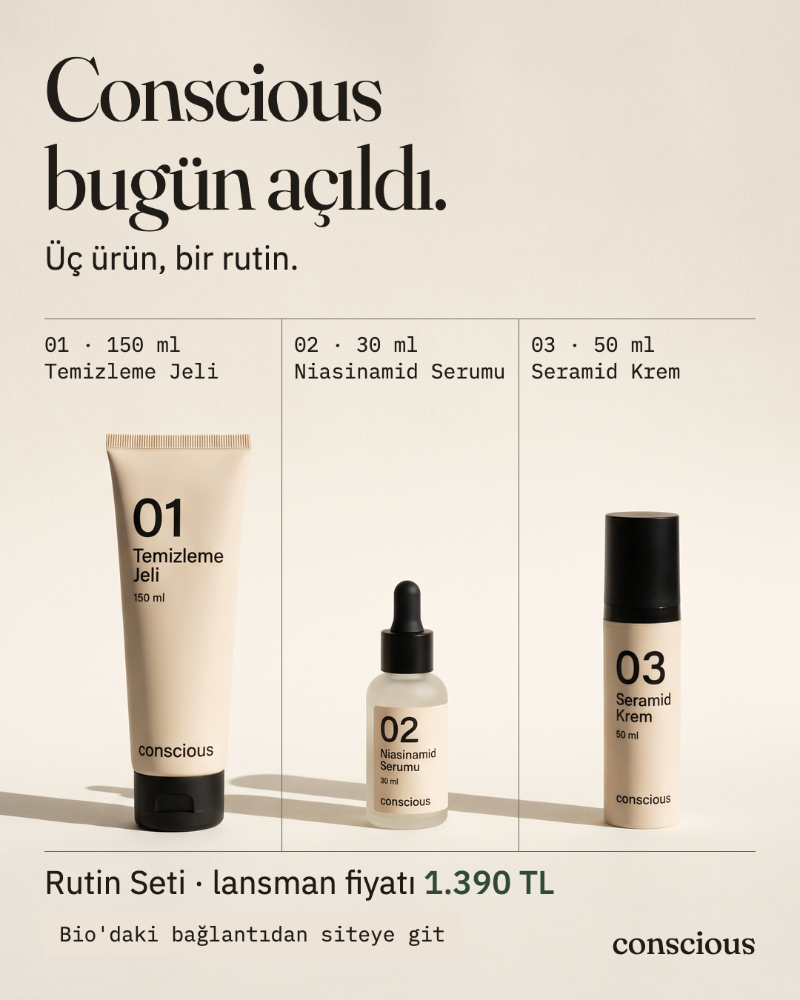
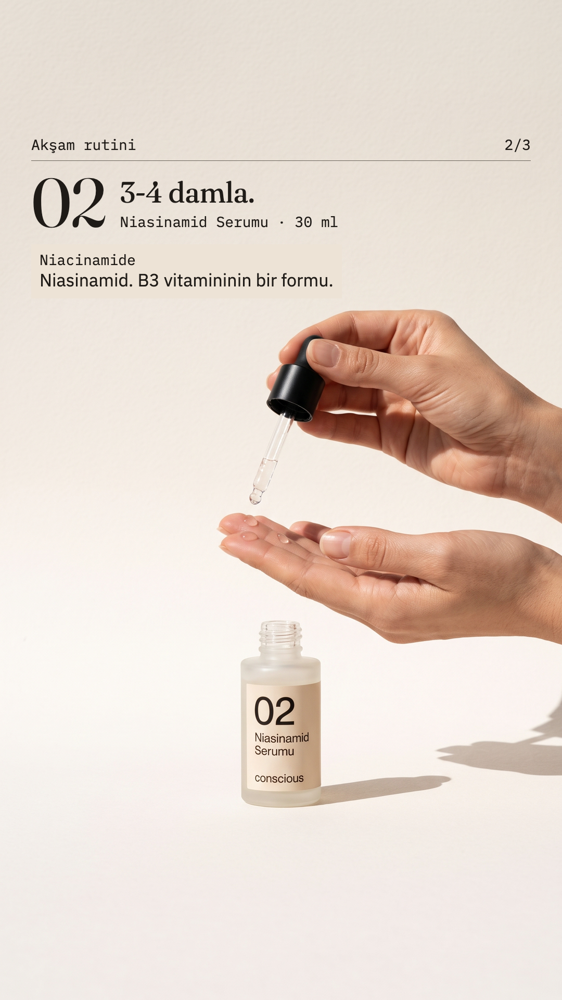
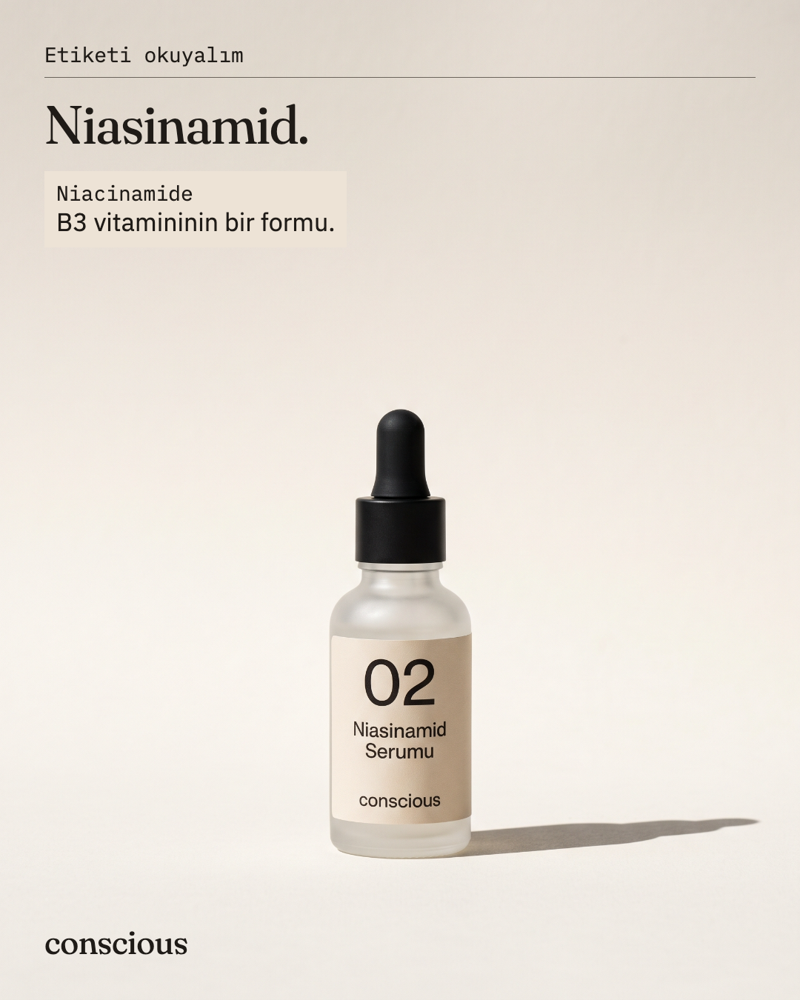
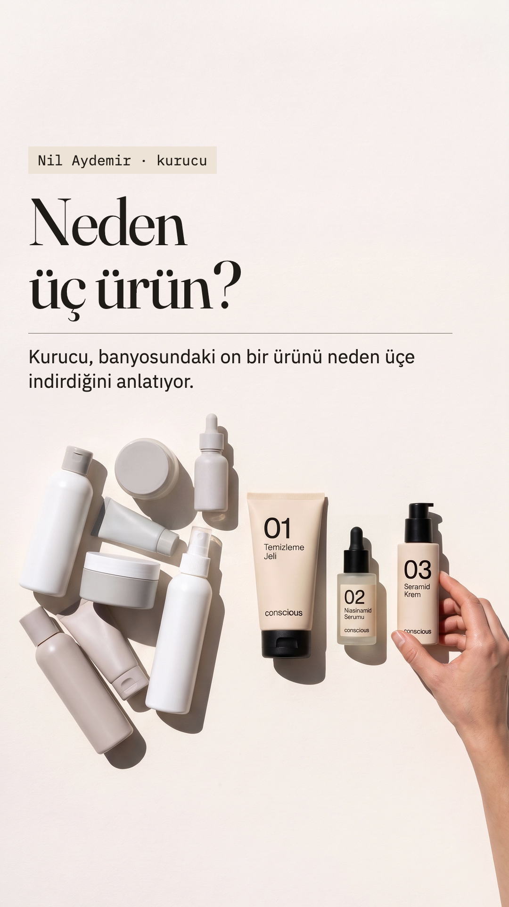
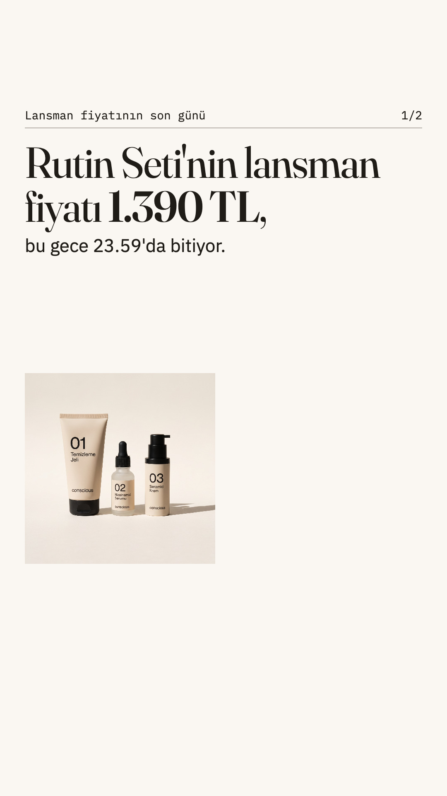

# Conscious — a launch week built with Claude Code

A complete launch week for **Conscious**, a fictional three-product skincare brand: brand decisions, a design system, social posts, stories, a Reels cover, short videos, a live product page, and a reusable **content factory** that turns a content calendar into finished, checked assets.

> Conscious is a fictional brand created for a course exercise. The brand kit (brief, visual direction, launch plan, calendar) was provided by the course; everything else in this repo was produced with Claude Code.

**Live product page:** https://conscious-cnhsk.vercel.app

| Launch post | Routine story | Ingredient carousel | Reels cover | Last-day story |
|---|---|---|---|---|
|  |  |  |  |  |

## What I did

1. **Chose a brand archetype.** Generated the same launch post under two archetypes (Sage vs. Caregiver), compared them, and picked **Sage**: trust through clarity — ingredient names next to their plain-language meaning, big product numbers, a grid, flat daylight. Decision and risks in [`karar.md`](karar.md).
2. **Wrote a design contract.** [`DESIGN.md`](DESIGN.md) fixes palette (with every text/background pair checked against WCAG), type scale, spacing, components, packaging description, safe areas per format, and banned claims/price language. Every later asset is audited against it.
3. **Kept text out of the image model.** Image models can't hit brand fonts or colours reliably, so models only generate text-free photos; all copy is an HTML layer rendered to PNG/MP4 with Playwright. Exact fonts, exact hex colours, measurable safe areas, free corrections.
4. **Built and audited the social set.** Posts, a 3-frame story, a Reels cover and an animated post, each checked for contrast, safe areas, source (every sentence must exist in the brand kit) and price language. Findings and fixes are logged in [`degerlendirme.md`](degerlendirme.md).
5. **Designed and shipped the product page.** Jobs-to-be-Done plan for two personas ([`site-plani.md`](site-plani.md)), plain HTML/CSS with no JavaScript (native `popover`, CSS `sticky`), mobile-first at 375 px, deployed to Vercel.
6. **Turned it into a factory.** A Claude Code skill plus a Node renderer that produces the whole week from `takvim.csv`, then audits every frame and writes a contact sheet and a report.

## The content factory

```
takvim.csv ──► plan.json ──► araclar/fabrika.mjs ──► cikti/hafta-1/
 (what/when)   (Claude:       (fills templates,       ├─ ISO-dated PNG / MP4
               pick or        renders with             ├─ -kontrol.png safe-area overlays
               generate       png.mjs / mp4.mjs,       ├─ index.html  contact sheet
               images,        audits every frame)      └─ rapor.md    report, spend, open questions
               write copy)
                    ▲
               DESIGN.md (how it looks) + AIDA weighting per day
```

- **Skill:** [`.claude/skills/icerik-fabrikasi/SKILL.md`](.claude/skills/icerik-fabrikasi/SKILL.md) — image catalogue, generation rules, copy rules, plan schema.
- **Templates:** [`post`](.claude/skills/icerik-fabrikasi/sablonlar/post.html) (1080×1350), [`story`](.claude/skills/icerik-fabrikasi/sablonlar/story.html) and [`kapak`](.claude/skills/icerik-fabrikasi/sablonlar/kapak.html) (1080×1920), weighted by funnel stage (attention → interest → desire → action).
- **Renderer:** [`araclar/fabrika.mjs`](araclar/fabrika.mjs) takes date, weekday, time and format from the calendar only, and checks text placement (glyph ink bounds), contrast against the actual photo behind the text, loaded fonts, source of every sentence, and price/date rules.
- **First run:** 13/13 assets, 0 audit warnings, 2 new image generations ($0.202). See [`cikti/hafta-1/rapor.md`](cikti/hafta-1/rapor.md).

### Run it

```bash
cd araclar && npm install && npx playwright install chromium && cd ..
node araclar/fabrika.mjs cikti/hafta-1/plan.json
```

Image generation (Wiro) is done by Claude through MCP while following the skill; the renderer itself only needs Node, Playwright and ffmpeg-static.

## Repo map

| Path | What it is |
|---|---|
| `marka-brief.md`, `gorsel-yon.md`, `lansman-haftasi.md`, `takvim.csv`, `urun-sayfasi-brief.md`, `marka-kiti.*` | Course-provided brand kit (inputs) |
| `CLAUDE.md` | Working rules for Claude Code in this project |
| `karar.md`, `DESIGN.md` | Archetype decision and design contract |
| `degerlendirme.md` | Audits, critiques and open questions, step by step |
| `site-plani.md`, `site/` | Product page plan and the deployed page |
| `cikti/` | Outputs: M1 comparison, social set, motion, before/after, factory run |
| `araclar/` | `png.mjs` (HTML → PNG), `mp4.mjs` (CSS animation → MP4, frame by frame), `fabrika.mjs`, `indir.sh` |
| `.claude/skills/icerik-fabrikasi/` | The content factory skill and its templates |

## Tools and cost

- **Claude Code** for planning, writing, building and auditing.
- **Wiro** for generation: `google/nano-banana-2` (images), `black-forest-labs/flux-2-pro` (one comparison image), `klingai/kling-v3` (one 5-second video). 19 generations, **$2.012** in total, every one logged in [`cikti/wiro-harcama.csv`](cikti/wiro-harcama.csv).
- **Playwright** and **ffmpeg-static** for rendering and measurement; **Vercel** for hosting.

## Open items

Two questions are waiting for the (fictional) product and compliance owner: the full ingredient list and an approved answer to "my skin reddens easily, can I use it?". Until then the page shows a placeholder instead of an invented claim — see "Selin'e sorulacaklar" in [`degerlendirme.md`](degerlendirme.md).
